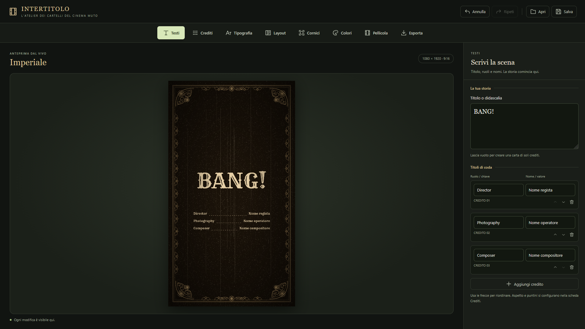
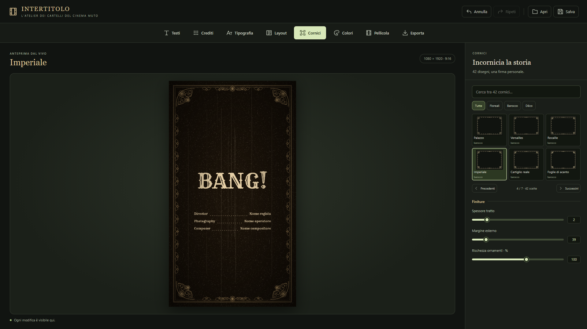
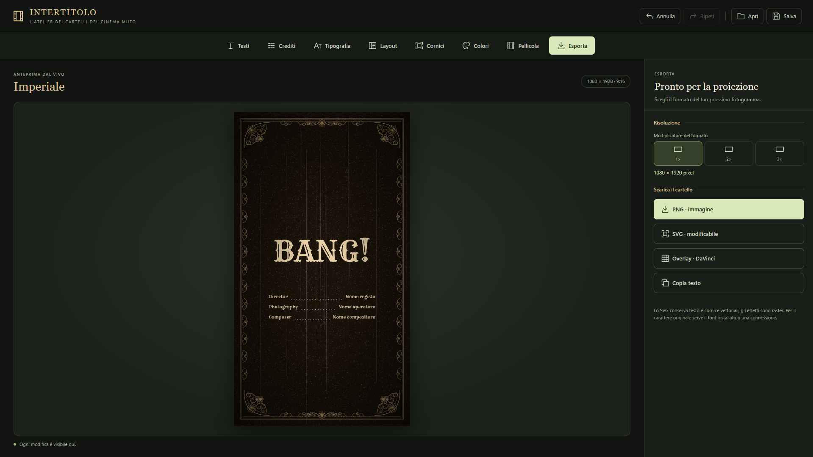

# 🎬 Intertitolo

> **L'atelier dei cartelli del cinema muto** — Un editor web per creare intertitoli e cartelli in stile cinematografo d'epoca, direttamente nel browser.

Intertitolo è una **single-page application** in HTML, CSS e JavaScript puro che permette di comporre cartelli cinematografici con testo, crediti, cornici ornamentali, effetti pellicola e palette d'epoca — con esportazione pronta per la proiezione o il montaggio.

Nessun build step, nessuna dipendenza, nessun server: **apri il file e inizia a scrivere.**

---

## ✨ Caratteristiche

| Categoria | Dettagli |
|-----------|----------|
| 📝 **Testi** | Titolo/didascalia multilinea + crediti dinamici (ruolo · nome) con riordino, aggiunta e rimozione |
| 🎭 **Crediti** | Colonne, allineamenti indipendenti (ruolo/nome), larghezza, interlinea |
| ··· **Separatori** | Puntini, linea o nessuno — con controllo di altezza (start/center/bottom), spaziatura, dimensione e gap |
| 🔤 **Tipografia** | 30+ font Google selezionati per didascalie, titoli, lettering e gotico — con ricerca e paginazione |
| 📐 **Layout** | Formati **16:9**, **4:3**, **9:16**, **1:1** · allineamento orizzontale/verticale · modalità "solo cornice" · sfondo trasparente |
| 🖼️ **Cornici** | 42 stili decorativi (barocco, floreale, déco, botanica) con spessore, margine e ricchezza ornamenti |
| 🎨 **Colori** | 6 atmosfere d'epoca (argento, ambra, notturno, seppia, salvia, rubino) + palette personalizzata |
| 🎞️ **Pellicola** | Grana, graffi, polvere e vignettatura regolabili — animabili in anteprima |
| 💾 **Progetti** | Salvataggio/caricamento JSON, autosave su `localStorage`, undo/redo (fino a 60 step) |
| 📤 **Esporta** | PNG, SVG vettoriale, overlay trasparente per **DaVinci Resolve**, copia testo |

---

## 🚀 Avvio rapido

### Opzione 1 — In locale

1. **Scarica** o clona la repository.
2. **Apri `index.html`** nel browser (Chrome, Firefox, Edge, Safari).
3. Scrivi, incornicia, esporta. Fine.

> 💡 Non serve installare nulla. La connessione internet serve solo per caricare i font Google e il font nel file SVG esportato.

### Opzione 2 — Online, senza installare nulla

Puoi provare Intertitolo direttamente dal browser, senza scaricare file:

**👉 [https://h4meln.github.io/interlinea/](https://h4meln.github.io/interlinea/)**

> La versione online è la stessa app, servita tramite **GitHub Pages**. Se riscontri problemi di caricamento, verifica che il link sia ancora attivo o apri `index.html` in locale.

---

## 📸 Screenshot

> *Le immagini che seguono mostrano l'interfaccia dell'editor. Per una panoramica visiva completa, apri la [demo live](https://h4meln.github.io/interlinea/).*

### Interfaccia principale

L'app è divisa in tre zone: **header** con i comandi di progetto, **barra delle schede** per gli strumenti, e l'area di lavoro con **anteprima canvas** a sinistra e **pannello controlli** a destra.



*Didascalia: anteprima live del cartello con il pannello "Testi" aperto. A destra, i controlli di tipografia; a sinistra, l'anteprima aggiornata in tempo reale.*

### Pannello Cornici

Il catalogo delle **42 cornici decorative**, organizzato per famiglia (floreale, barocco, déco, botanica), con miniature generate in tempo reale e filtri di ricerca.



*Didascalia: griglia delle cornici con anteprime vettoriali e controlli di finitura (spessore, margine, ricchezza ornamenti).*

### Esportazione

La scheda **Esporta** permette di scegliere il moltiplicatore di risoluzione (1×, 2×, 3×) e il formato di download: PNG, SVG, overlay per DaVinci o copia del testo.



*Didascalia: opzioni di esportazione con anteprima della dimensione finale in pixel.*

---

## 🧭 Interfaccia

L'app è organizzata in due aree:

```
┌─────────────────────────────────────────────────┐
│  Header · Annulla / Ripeti / Apri / Salva       │
├─────────────────────────────────────────────────┤
│  Tab: Testi · Crediti · Tipografia · Layout ... │
├────────────────────────┬────────────────────────┤
│                        │                        │
│   ANTEPRIMA LIVE       │   PANNELLO CONTROLLI   │
│   (canvas)             │   (a schede)           │
│                        │                        │
├────────────────────────┴────────────────────────┤
│  Status · Dimensione · Adattamento testo        │
└─────────────────────────────────────────────────┘
```

### Le 8 schede

- **Testi** — titolo/didascalia e gestione dei crediti
- **Crediti** — composizione, allineamenti e separatori
- **Tipografia** — font, dimensioni, interlinea, spaziatura
- **Layout** — formato, posizione del blocco, visibilità
- **Cornici** — 42 decorazioni + finiture
- **Colori** — atmosfere e palette
- **Pellicola** — effetti fotochimici
- **Esporta** — risoluzione e download

---

## 🖼️ Guida passo-passo: il tuo primo cartello

1. **Apri l'app** (in locale o dalla [demo live](https://h4meln.github.io/interlinea/)).
2. Nella scheda **Testi**, scrivi il titolo nel campo *"Titolo o didascalia"* — oppure lascia vuoto per un cartello di soli crediti.
3. Aggiungi i crediti con **"Aggiungi credito"**: inserisci ruolo (es. *Regia*) e nome.
4. Passa alla scheda **Cornici** e scegli uno stile dal catalogo (prova *"Palazzo"* o *"Camelie"*).
5. Nella scheda **Colori**, seleziona un'atmosfera — ad esempio *Ambra* o *Seppia*.
6. Regola **Tipografia** e **Layout** fino a ottenere l'equilibrio desiderato.
7. Vai su **Esporta** e scarica il tuo cartello in PNG, SVG o overlay per DaVinci.

> 💡 Ogni modifica è **immediatamente visibile** nell'anteprima. Usa **Annulla/Ripeti** per sperimentare senza paura.

---

## 📤 Formati di esportazione

| Formato | Quando usarlo |
|---------|---------------|
| **PNG** | Immagine raster pronta (1×, 2×, 3×) |
| **SVG** | Vettoriale modificabile — testo e cornice restano editabili |
| **Overlay DaVinci** | PNG trasparente da trascinare sopra una clip in Resolve |
| **Copia testo** | Testo pulito per un `Text+` in DaVinci o per appunti |

> ⚠️ Gli effetti pellicola sono **rasterizzati** anche nell'SVG. Per il carattere originale serve il font installato o una connessione attiva.

---

## ⌨️ Scorciatoie

| Tasto | Azione |
|-------|--------|
| `Ctrl/⌘ + Z` | Annulla |
| `Ctrl/⌘ + Shift + Z` | Ripeti |
| `←` `→` `Home` `End` | Naviga tra le schede (con focus sulla tab) |

---

## 📄 Licenza

Distribuito per uso libero e creativo. I font sono forniti da **Google Fonts** e soggetti alle rispettive licenze (per lo più SIL Open Font License).

---

**Intertitolo** · *La storia comincia da un cartello.*

[🌐 Prova la demo live](https://h4meln.github.io/interlinea/)
